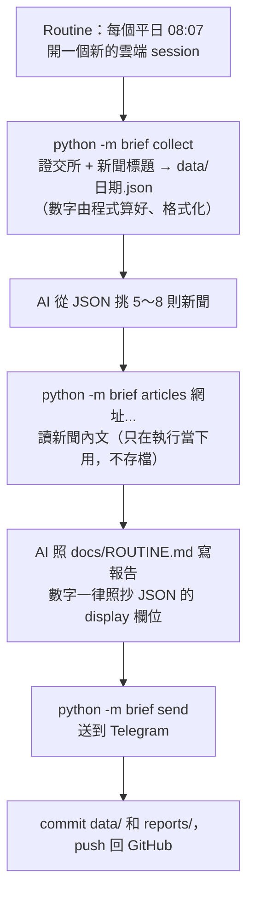

# claude-cloud-premarket-brief

用 **Claude Code 雲端 session** 從零寫出來、用 **Routines（排程）** 每個交易日早上自動執行的台股盤前資訊整理工具。這是一個 PoC，用來實際測試 Claude Code 的雲端功能能做到什麼程度。

> **只整理公開資訊，不構成投資建議。** 觀察清單只放大盤和 ETF，不碰個股。

完整的實測心得（花了多少、踩了哪些坑）：⚠️ 文章網址待補

## 它做什麼

每個交易日 08:07，雲端會自動：

1. 抓前一個交易日的證交所資料（加權指數、成交金額、漲跌家數、三大法人、融資融券、類股、觀察清單 ETF、除息預告）和三個新聞來源的標題。
2. 挑出 5～8 則新聞，讀內文。
3. 寫一份盤前整理，送到 Telegram，再把資料和報告存回 GitHub。

報告長這樣（節錄，完整範例在 [examples/report-2026-10-08.md](examples/report-2026-10-08.md)）：

```
📊 台股盤前整理｜2026-10-08
資料日：2026-10-07

今日重點
1. 加權指數小跌（-0.03%），但上漲 588 家多於下跌 387 家，兩者方向不一致；
   外資、投信、自營商三者都是賣超。
2. 三大法人合計 -241.6 億、外資 -130.4 億；鉅亨網內文列出的外資賣超前 10 名裡，
   有觀察清單的 0050（內文寫 2.41萬張，JSON 外資 -24,147 張）……
3. 今天的行事曆有行政院會、內政部公布 9 月人口統計、財政部公布 9 月進出口統計……

大盤 加權指數 49,806.37（-16.18，-0.03%），成交金額 9,862.8 億，上漲 588 家、下跌 387 家
法人 外資 -130.4 億、投信 -33.2 億、自營商 -78.0 億，合計 -241.6 億
……
```

休市日只送一行「今天休市，不發盤前整理。」（[範例](examples/report-2026-10-09-holiday.md)）。

## 架構



設計重點：**數字由程式算，AI 只照抄、只寫文字。** AI 不能自己換算，也不能上網另外查數字，所以報告裡的數字可以用程式逐項核對。

## 這個 repo 是怎麼來的

程式碼全部由 Claude Code 雲端 session 照 [docs/SPEC.md](docs/SPEC.md) 從零寫出來，人只負責寫規格和審 PR：

| 版本 | 做什麼 | 雲端 session 花的時間 |
|---|---|---|
| v1 | `check`、`collect`、`send` | 約 40 分鐘 |
| v1.1 | 對證交所的請求從 12 次降到 6 次（雲端主機會被擋）、修正法人算法 | 約 20 分鐘 |
| v2 | `articles`：讀新聞內文，寫「今日重點」和新聞摘要 | 約 40 分鐘 |

開發和執行時遇到的問題都記在 [docs/PITFALLS.md](docs/PITFALLS.md)，雲端主機的連線測試結果在 [docs/CONNECTIVITY.md](docs/CONNECTIVITY.md)。

## 在本機跑

需要 Python 3.11 以上。

```bash
pip install -e ".[dev]"

python -m brief check        # 測每個資料來源連不連得到（會判斷證交所的擋頁）
python -m brief collect      # 抓資料，輸出 data/<報告日>.json
python -m brief articles <新聞網址>...   # 印出新聞內文（JSON），不存檔
python -m brief send reports/<報告日>.md --dry-run   # 只印出轉換後的訊息，不送出

pytest                       # 測試不打網路
```

要真的送到 Telegram，設定兩個環境變數：

```bash
export TELEGRAM_BOT_TOKEN=...   # BotFather 給的 token
export TELEGRAM_CHAT_ID=...     # 你的 chat id
```

觀察清單在 [config.toml](config.toml)。

## 在雲端每天自動跑

完整設定在 [docs/ROUTINE.md](docs/ROUTINE.md)，重點：

1. **把這個專案推到你自己的 GitHub repo**，讓 Claude 的 GitHub App 看得到。
2. **建一個雲端環境**：
   - 網路選「自訂」，允許清單加上證交所、三個新聞來源、Telegram 的網域（清單在 ROUTINE.md）。**要在開 session 之前加**，執行中的 session 改了不會生效。
   - 環境變數放 `TELEGRAM_BOT_TOKEN`、`TELEGRAM_CHAT_ID`、`TZ=Asia/Taipei`。Telegram 的 token 在網址裡，用不了「API 憑證」功能。
3. **建 Routine**：選雲端、你的 repo、上面的環境、Sonnet 5.5、每個平日 08:07；指示只要兩句，叫它照 `docs/ROUTINE.md` 做。之後改步驟或格式只要改 repo 裡的檔案。

費用參考（Claude Code `/usage` 的估算，不是帳單）：每天跑一次約美金 $0.50。Routines 扣的是訂閱用量，不是雲端 session 的促銷額度。

## 已知限制

- **證交所會擋雲端主機**：擋頁的狀態碼可能是 200 或 307。請求太密集時會被擋得越來越多，所以程式每次只打 6 個證交所網址，同網域間隔 3 秒。ETF 法人那支（T86）偶爾還是會被擋，報告會寫「無資料」。
- 鉅亨網的新聞 API 一頁只有 30 則，前一天下午收盤後的新聞可能抓不到。
- 開休市日期只有當年度的清單。
- 排程主機上的 `python3` 是 3.11、沒有 requests，[docs/ROUTINE.md](docs/ROUTINE.md) 寫死用 `/usr/bin/python3.13`。

## 資料來源

- 行情、法人、融資融券、開休市日期、除息預告：[臺灣證券交易所](https://www.twse.com.tw/)。使用前請自行確認證交所的資料使用規範。
- 新聞：Yahoo 股市、經濟日報、鉅亨網。**只存標題和連結**；內文只在執行當下讀來寫摘要，不存進 repo，版權屬於原媒體。
- `tests/fixtures/` 裡的新聞段落是照網頁結構編的假文字，不是真實新聞。`tools/` 的兩支工具會抓真實網頁，只在本機重做 fixture 時用。

## 授權

[MIT](LICENSE)
